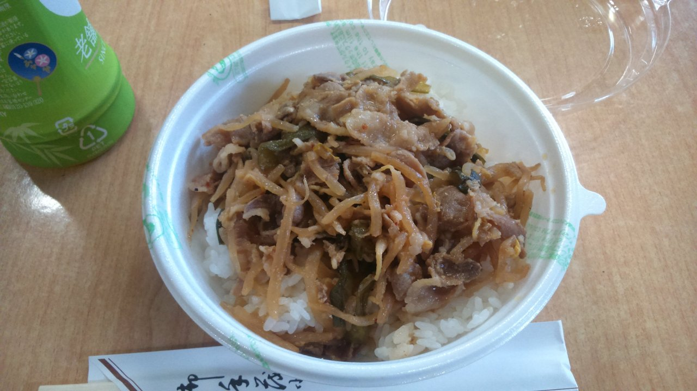

「豚たっぷり焼肉丼」360円。

2015年10月2日14時半ごろのガッキにて伊右衛門と一緒に購入。

早速蓋を開けて割り箸で喫食開始。2年間食べた経験通りの「ガッキの焼肉丼」である。しかし何かがいつもと違ったので気をつけて食べてみると問題はご飯だった。水を入れ過ぎなのかどうかはよくわからないがネチョネチョしている失敗作ご飯の上に「焼き肉」（食べたことあればこのカギカッコの意味がわかってもらえるはず）がのっているようである。完食するまでごはん粒の食感が希薄な上、たまにおはぎのなりそこないみたいに塊があり、つらいものがあった。この時点でどうかと思ったがこれではまだ終わらない。

売り文句通り豚肉メインである上の説明をしてみたい。学食としては安い豚肉は適切だとおもう。豚肉と一緒にニラともやしが使われており、まあ焼き肉か…？と言った趣のシロモノである。しかしまず油が大変多いという点、またどんな調理方法をしたのか知らないがもやしもニラも油まみれでテカりつつくたくたになっていやがるのである。シャキシャキとかコシといった言葉からは1光年ぐらい離れている。ここで食べる手を止め、考えてみた。これはそもそも焼いているというより炒め煮なのでは無いのか。売り文句に偽りありだがそもそもガッキローテーションメニューの中に幾つかある焼肉、ないし炒め丼と付いたメニューはすべて差別化が具材によってのみなされていることはガッキユーザーなら周知の事実なのである。

ここまで来て味の説明をしていない。食レポにあるまじき構成だが言ってしまえば「特筆すべき味が無い」。松屋の牛丼のごとく舌に感じられる甘辛い塩気もなく、かと言ってあっさりと言うには油がギトギト。口に入れても味覚的な刺激に薄い何かがこのメニューである。「焼き肉」に唐辛子のかけらは見えるが辛味もあまりない。

食感として肉のかけらのみしか感じられず、ヨーロッパで出てくるようなクタクタの煮物を食っている印象。普通ならごはん粒の食感がある、というか今まではあったのだが今日はその想定すら裏切られるほどのご飯であった。空腹感があってようやく食えるレベル。油の多さももはや温かくても辛いものがあり、胃もたれ不可避である。丼に汁気を出したいなら油ではなく出汁ベースでやっていただきたい。

（これでも個人的にガッキのメニューとしては「食える」部類に入るのが問題）
